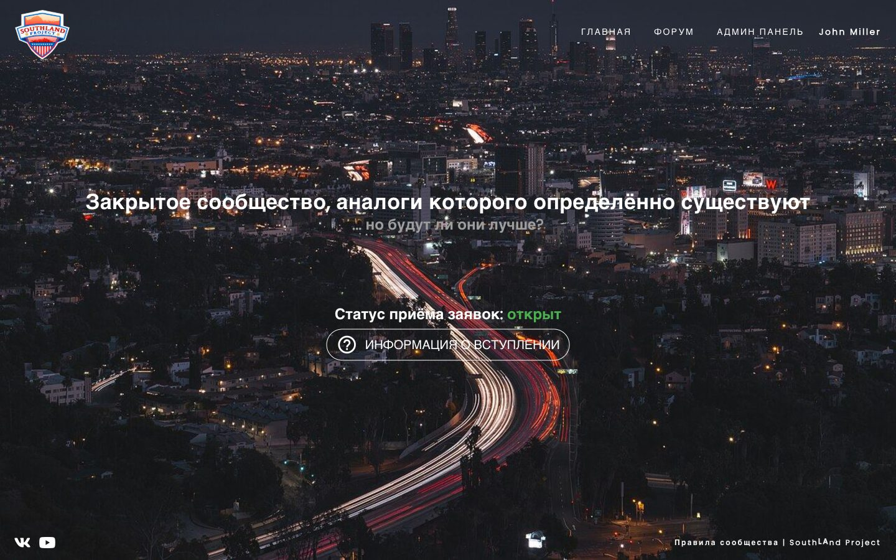
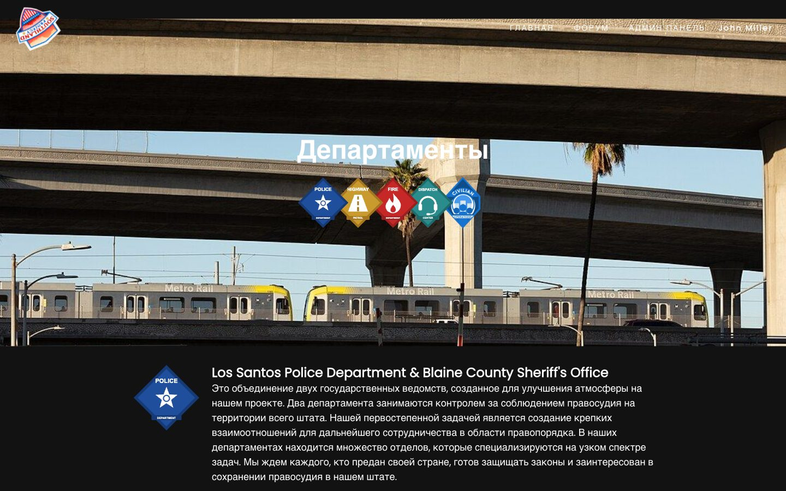
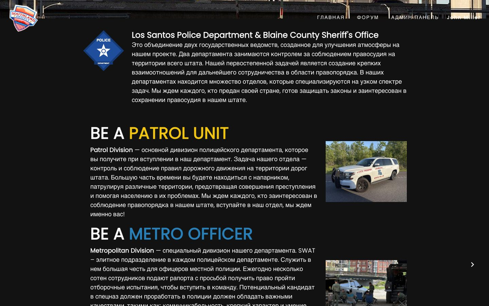
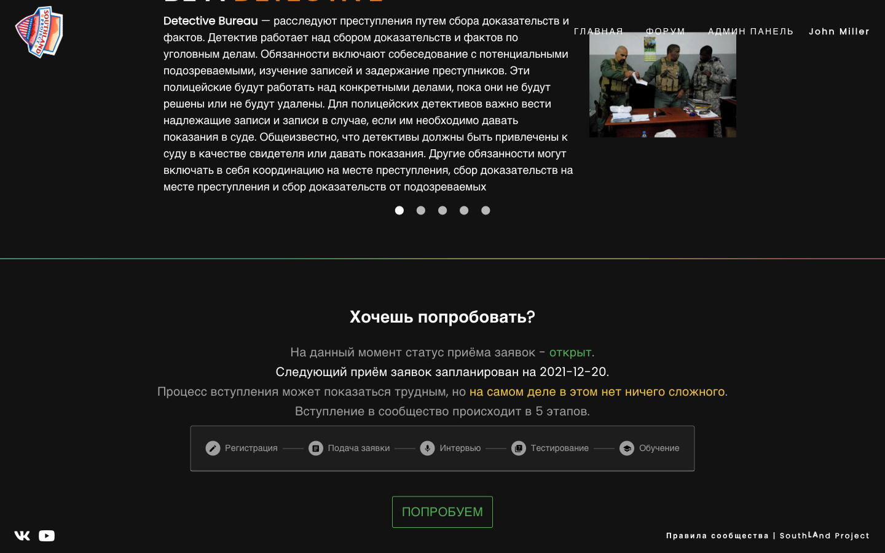
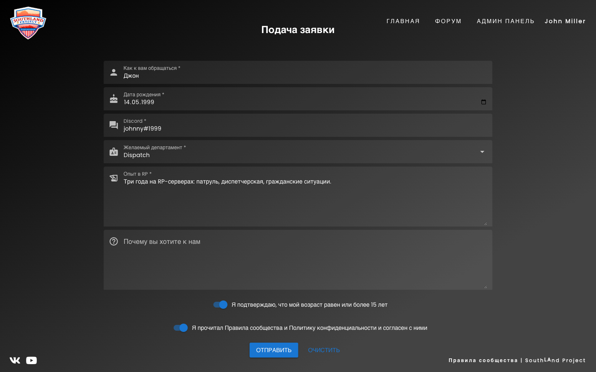
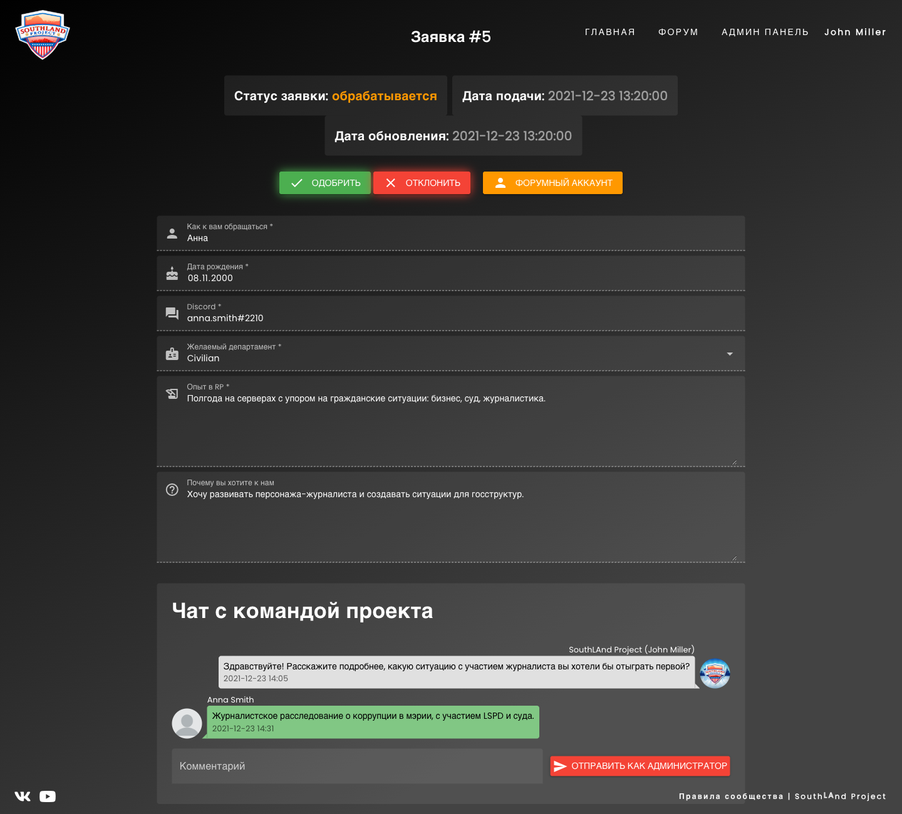
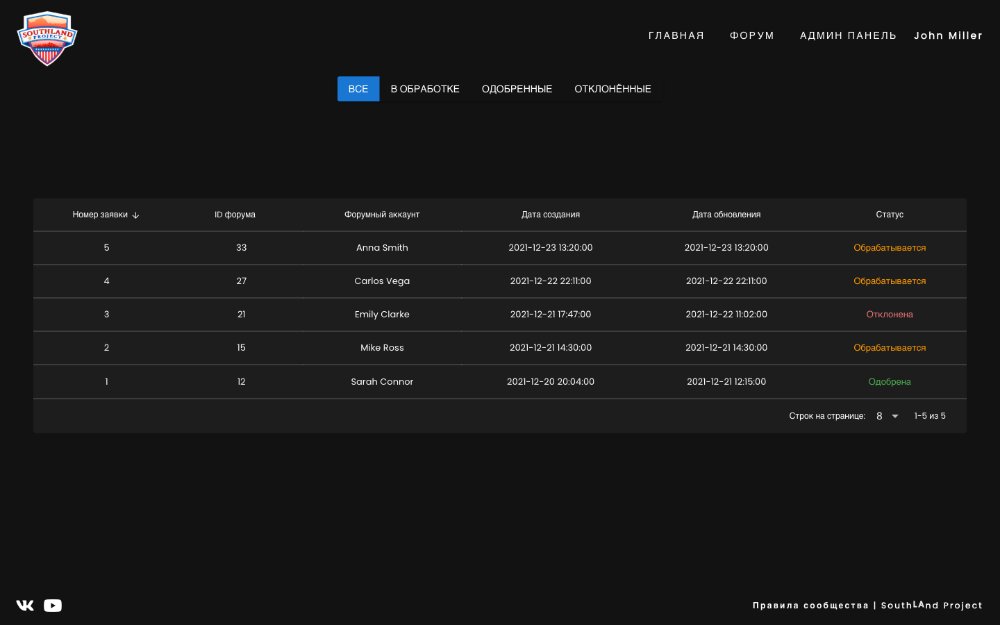

# Hello Southland

The website of Southland, a GTA V roleplay community (2021–2022): a landing page that introduces the project and its departments, and an application system for joining it. Members sign in with their forum account, fill in an application form, and talk to the team in a chat on the application page. Admins review applications and accept or decline them. The interface is in Russian.


## Screenshots

### Landing page

| | |
|---|---|
|  Hero section |  Departments |
|  Department carousel |  How to join |

### Applications

| | |
|---|---|
|  Application form |  Application page with the team chat |
|  Admin list with status filters | |

## Features

- **Landing page**: a loading animation, parallax and scroll-driven image scaling, a carousel with a slide per department, and a step-by-step "how to join" section.
- **Applications**: the form is built from a field list stored in the database (text, date, select and so on), so it can change without a deploy. Applications can be opened and closed, and a member can only have one pending application.
- **Chat**: members and admins exchange comments on the application page. Admin messages are shown on behalf of the project.
- **Admin panel**: all applications with status filters, accepting and declining.
- **Forum login**: sign-in uses the IPS4 forum session cookie, and admin rights come from forum groups.

## Stack

- **Frontend:** Vue 3, Quasar 2, TypeScript, Vuex, axios.
- **Backend:** Node.js, Express, Sequelize (MySQL / MariaDB).

## Structure

```
frontend/              Quasar app
  src/pages/           landing page, application form, application page, admin list
  src/layouts/         header, footer and loading screen
  public/images/       landing photos, department emblems, logo
backend/               Express API under /api
  routes/index.js      auth, applications, comments, settings
  utils/               config (environment variables), Sequelize models, forum user
```

## Running

The backend needs two MySQL databases: the IPS4 forum database (for login) and its own database with the `settings`, `applications` and `comments` tables.

```sh
# backend: set the variables from backend/.env.example, then
cd backend
yarn install
node bin/www

# frontend: the dev server proxies /api to the backend (API_URL, default http://localhost:6663)
cd frontend
yarn install
npx quasar dev
```

For production, build the frontend with `npx quasar build` and serve it together with the backend's `/api` on the same host.

The landing photos are public domain or CC0 images from Wikimedia Commons, listed in [frontend/public/images/landing/CREDITS.md](frontend/public/images/landing/CREDITS.md). The original screenshots from the project's forum are no longer available.
